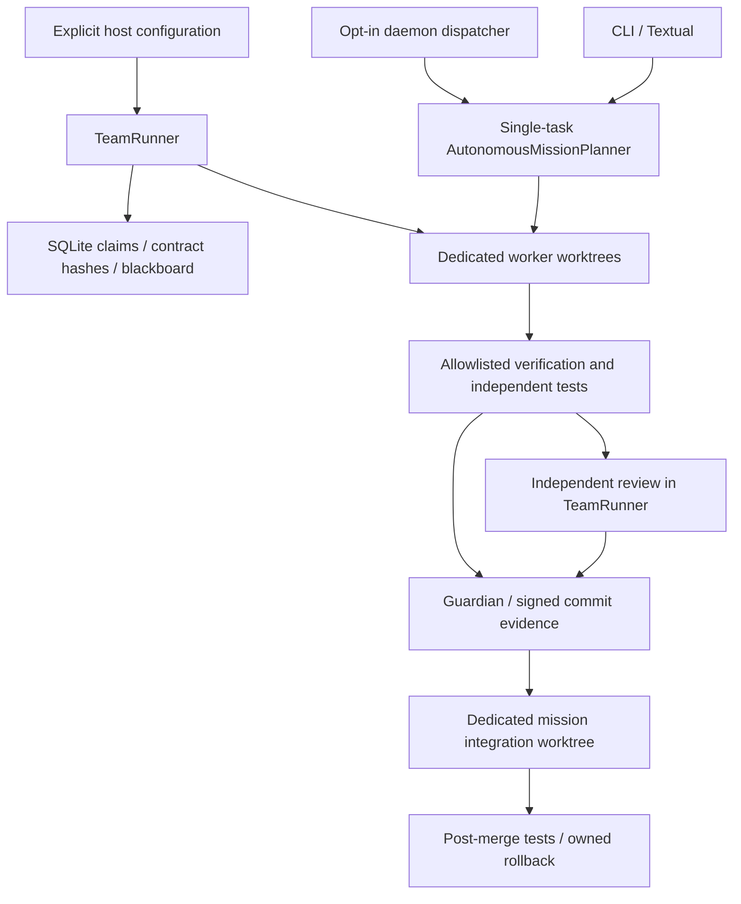

# Actual upgrade architecture

The orchestrator CLI uses argparse; the separately packaged agpair bridge uses
Typer. Textual is retained. SQLite stores missions, tasks, checkpoints, audit,
memories and approvals. New stores use additive tables shared with migrations.

The two orchestration paths are explicit; the natural-language planner does not
silently gain multi-agent behavior. TeamRunner runs bounded concurrent independent
tasks and sequential integrations. Real provider tester/reviewer adapters remain
unimplemented. Claims coordinate cooperating workers, not OS filesystem access.

ProcessSupervisor owns a new process session and uses a stdlib child subreaper
helper, separate from the controller, to terminate/reap descendants. Limits are
per process; aggregate controller/MCP/disk budgets remain incomplete. Real worker
supervision requires bwrap and explicit local verification. New flags default off.

External MCP verification uses bounded JSON-RPC stdio, exact catalog approval,
a read-only sandboxed sanitized workspace and the exact pre-approved harmless
operation. It is not a general remote-write integration. Existing MCP configs are
preserved and inventoried without being declared operational. Memory/FTS is reused
for advisory lessons. Imported reviews and all model/tool outputs remain data.
